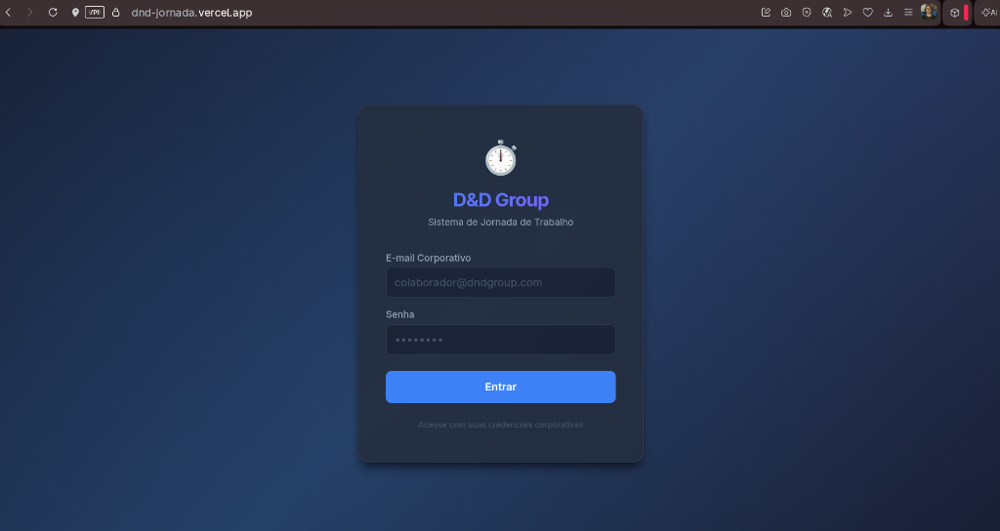
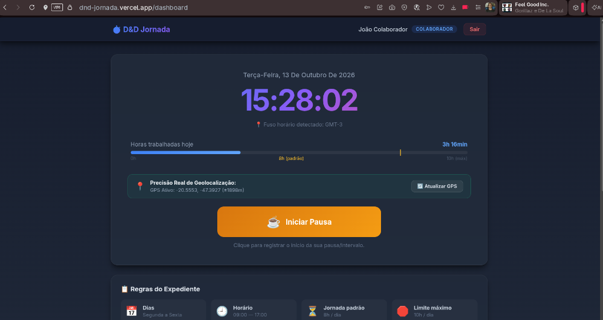
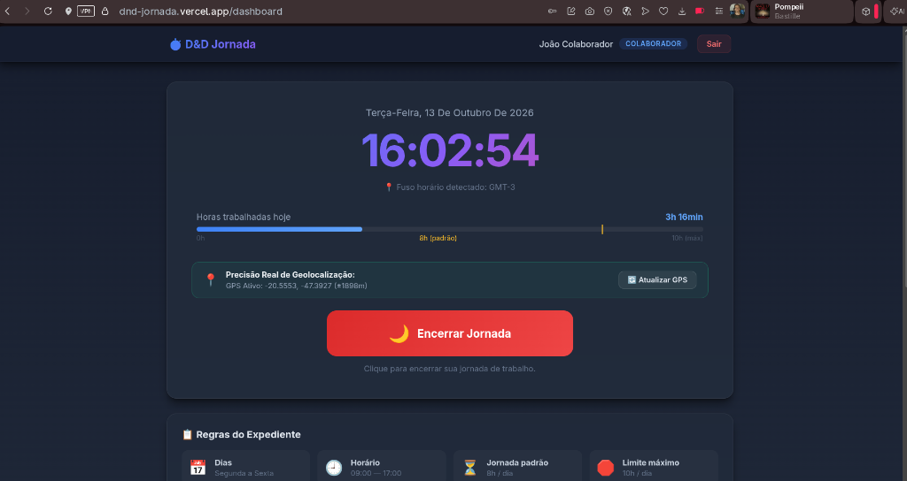
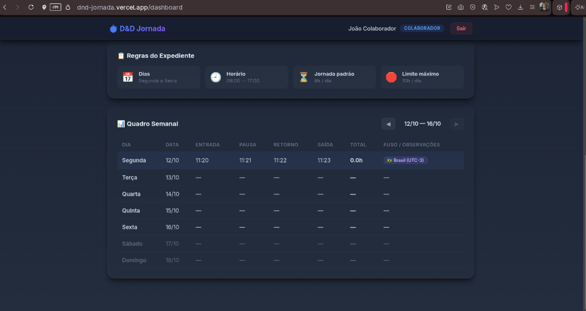
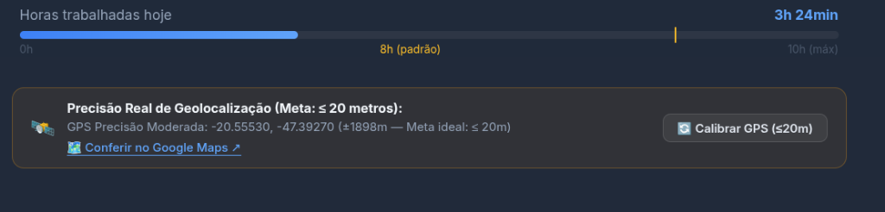
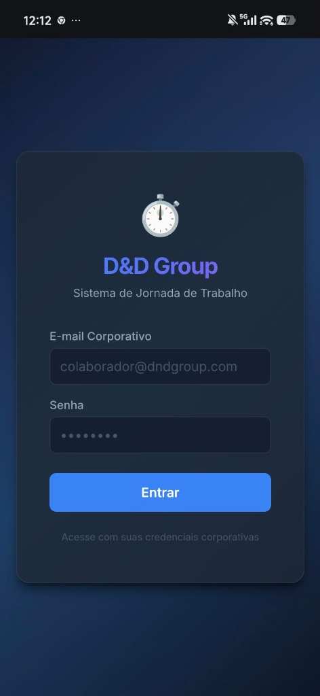
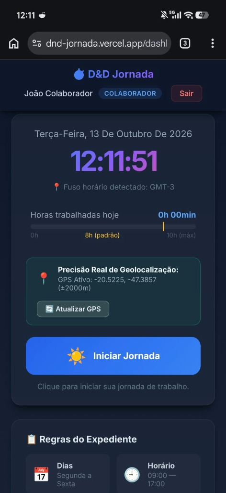
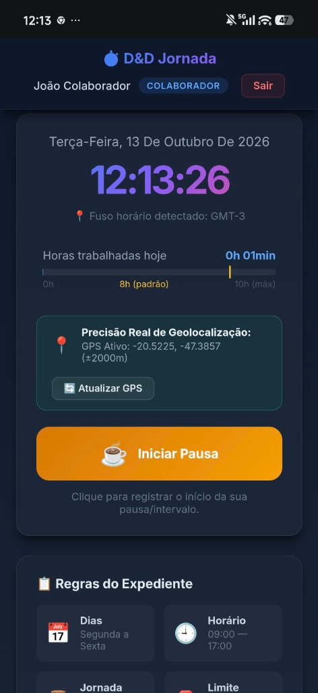
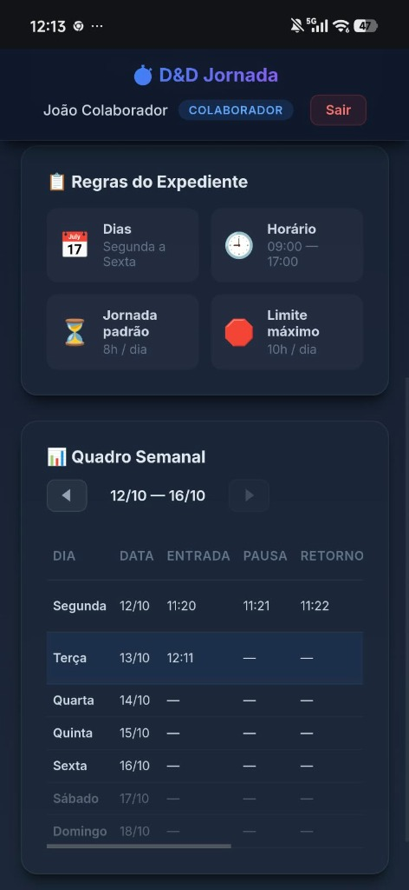
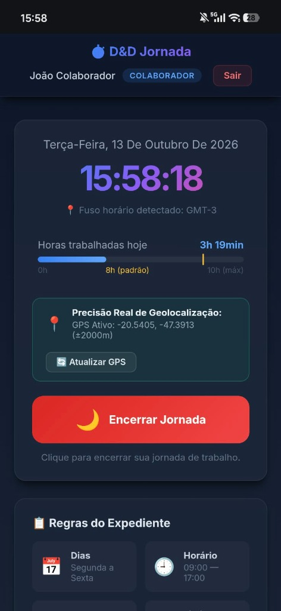

# D&D Jornada - Controle de Ponto Inteligente

Sistema de controle de ponto eletronico desenvolvido para empresas com equipes distribuidas entre o Brasil e a Europa (Portugal e Espanha). Desenvolvi este projeto de forma individual, cuidando de toda a arquitetura de dados, seguranca, regras trabalhistas da CLT e interface tanto para celular quanto para computador.

---

## Acesso Online (Deploy na Vercel)

A aplicacao esta publicada e pode ser testada diretamente pelo navegador:

[Acesse a Aplicacao na Vercel](https://dnd-jornada.vercel.app)

---

## Demonstracao Visual

### Versao Desktop (Painel do Colaborador, Gestor e RH)

Telas da aplicacao em uso no computador:

#### Tela de Login


#### Painel Principal - Inicio de Intervalo


#### Painel Principal - Encerramento de Jornada


#### Quadro Semanal e Regras do Expediente


#### Calibracao de Geolocalizacao em Tempo Real e Link para o Google Maps


---

### Versao Mobile (Aplicativo para Celular)

Telas da aplicacao em uso no smartphone:

| Tela de Login | Inicio de Jornada | Inicio de Pausa |
| :---: | :---: | :---: |
|  |  |  |

| Quadro Semanal de Pontos | Encerramento de Jornada |
| :---: | :---: |
|  |  |

---

## Contas de Acesso para Testes

O banco de dados ja esta populado com contas configuradas para testar todos os perfis e fusos horarios. Todas as contas utilizam a mesma senha: `password123`.

| Perfil | E-mail | Senha | Cenário de Teste |
| :--- | :--- | :--- | :--- |
| Colaborador Brasil (Joao) | `colaborador@dndgroup.com` | `password123` | Bater ponto no fuso de Sao Paulo (UTC-3), ver horas trabalhadas e regras de intervalo. |
| Colaboradora Lisboa (Maria) | `colaborador2@dndgroup.com` | `password123` | Conta individual da colaboradora em Lisboa (UTC+1) com conversao automatica de horario. |
| Colaborador Madri (Carlos) | `colaborador3@dndgroup.com` | `password123` | Conta individual em Madri (UTC+2) com jornada superior a 10h e justificativa visivel. |
| Gestor (Silva) | `gestor@dndgroup.com` | `password123` | Visao consolidada da equipe, alertas de horas excedentes (>10h) e ocorrencias de ponto. |
| RH / Administrador | `rh@dndgroup.com` | `password123` | Auditoria geral de todas as batidas, relatorios e acao de fechamento mensal de folha. |

---

## Decisoes Tecnicas e Regras de Negocio

Para detalhes completos sobre por que usei o Supabase, por que nao subi arquivos do banco por seguranca, requisitos funcionais e nao-funcionais, integracao do GPS e regras da CLT:

[Consulte o documento completo: DECISOES_TECNICAS.md](DECISOES_TECNICAS.md)

---

## Como Acessar e Usar no Celular

Para testar a experiencia mobile, existem duas formas diretas:

### 1. Baixar e instalar o APK diretamente
Voce pode acessar o link do projeto pelo proprio navegador do celular, baixar o arquivo `.apk` gerado pelo projeto e confirmar a instalacao para rodar nativamente no Android.

### 2. Acesso direto pelo navegador do celular (PWA)
1. Abra o link do projeto (`https://dnd-jornada.vercel.app`) no navegador do celular (Chrome ou Safari).
2. Toque no menu do navegador e selecione "Adicionar a tela de inicio".
3. O icone do aplicativo ficara salvo na tela do seu aparelho e abrira em tela cheia, com acesso completo ao GPS e fluidez de um aplicativo nativo.

---

## Como Rodar o Projeto Localmente

Se quiser executar o projeto em ambiente de desenvolvimento local:

### 1. Clonar o repositorio
```bash
git clone https://github.com/gppacheco/dnd-jornada.git
cd dnd-jornada/dnd-jornada/web
```

### 2. Instalar dependencias
```bash
npm install
```

### 3. Configurar variaveis de ambiente
Crie o arquivo de ambiente a partir do exemplo fornecido:
```bash
cp src/environments/environment.example.ts src/environments/environment.ts
```
Preencha a URL e a chave publica Anon do seu projeto Supabase no arquivo `src/environments/environment.ts`.

### 4. Executar o servidor de desenvolvimento
```bash
npm start
```
Abra o navegador no endereco `http://localhost:4200`.

---

## Tecnologias Utilizadas

- Frontend: Angular 19 (arquitetura moderna com Signals, componentes standalone e controle fino de estado).
- Estilizacao: CSS3 puro, responsivo, com design escuro e tecnicas de glassmorphism.
- Backend e Persistencia: Supabase (PostgreSQL relacional com Row Level Security e autenticacao JWT).
- Geolocalizacao: Geolocation API com alta precisao, sintonizacao continua e filtro anti-coordenadas nulas.
