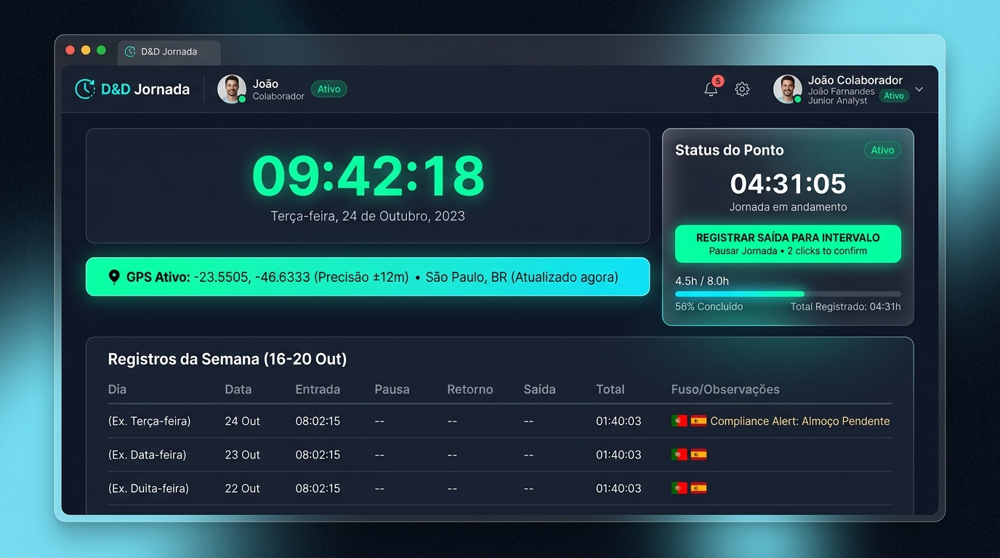
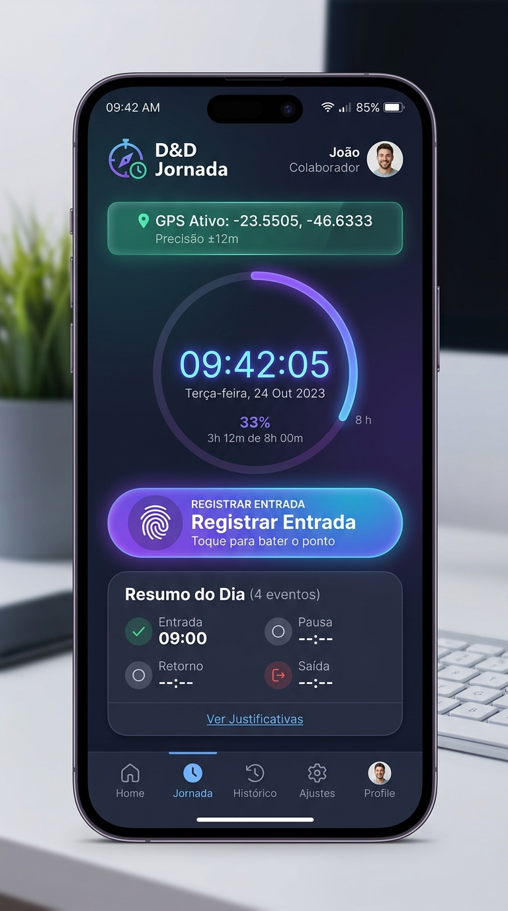

# ⏱️ D&D Jornada — Plataforma Corporativa de Controle de Ponto & Gestão de Jornada

Sistema inteligente, escalável e em conformidade jurídica para registro e auditoria de ponto eletrônico corporativo, desenvolvido para atender operações com colaboradores distribuídos geograficamente no **Brasil** e na **Europa** (Portugal e Espanha).

---

## 📸 Demonstração Visual do Sistema

### 🖥️ Painel Web Desktop (Colaborador, Gestor e RH)


### 📱 Aplicativo Mobile (Smartphone / Tablet)
<div align="center">
  
</div>

---

## 🎯 Arquitetura & Decisões Técnicas

Para detalhes aprofundados sobre todas as regras de negócio, modelagem de dados, conformidade jurídica (CLT e Portaria 671 MTE), máquina de estados e justificativas arquiteturais, acesse o documento dedicado:

👉 **[📖 Documentação Completa de Decisões Técnicas e Arquitetura (DECISOES_TECNICAS.md)](DECISOES_TECNICAS.md)**

---

## 🛡️ Decisões Arquiteturais de Destaque

### 1. Por que o Supabase foi escolhido?
Por se tratar de um **desafio técnico com prazo estrito**, a **velocidade de entrega, confiabilidade e qualidade técnica** foram prioridades absolutas:
- **Intermediação de Backend (BaaS Enterprise):** O Supabase elimina a necessidade de construir um servidor CRUD do zero (Node/Express/Nest), fornecendo um banco de dados relacional **PostgreSQL**, APIs automáticas REST e WebSocket (Realtime) nativas.
- **Autenticação Padrão e Segura:** Utilização nativa do Supabase Auth com geração e validação de tokens JWT padrão de mercado, criptografia de senhas (bcrypt) e controle de sessão gerenciado.
- **Foco no Core de Negócio:** Permitiu concentrar todo o tempo de desenvolvimento na experiência do usuário, precisão de fusos horários, cálculos UTC e regras trabalhistas complexas.

### 2. Segurança e Ocultação do Supabase no Repositório Público
Como o repositório no GitHub é **público**, adotou-se a decisão técnica e de segurança de **não versionar qualquer arquivo interno do Supabase** (pastas `supabase/`, `migrations/`, schemas internos, credenciais administrativas ou chave `service_role`):
- **Proteção da Arquitetura do Banco:** Evita expor a estrutura interna de tabelas, índices e funções aos visitantes do repositório.
- **Row-Level Security (RLS) Ativo:** Mesmo utilizando a chave pública (`anon public`) no frontend, toda a segurança de dados é garantida a nível de banco de dados através de políticas RLS rigorosas baseadas em `auth.uid()`. Um colaborador nunca consegue ler nem modificar pontos de outro colaborador, e alterações em períodos fechados são rejeitadas diretamente pelo PostgreSQL.

---

## 👥 Perfis de Acesso para Testes

O sistema já está populado com colaboradores, gestor e administrador de RH ativos para testes de conformidade:

| Perfil | E-mail | Senha | Localidade / Fuso Horário |
| :--- | :--- | :--- | :--- |
| **Colaborador 1 (João)** | `colaborador@dndgroup.com` | `password123` | 🇧🇷 Brasil (`America/Sao_Paulo` - UTC-3) |
| **Colaborador 2 (Maria)** | `colaborador2@dndgroup.com` | `password123` | 🇵🇹 Portugal (`Europe/Lisbon` - UTC+1) |
| **Colaborador 3 (Carlos)** | `colaborador3@dndgroup.com` | `password123` | 🇪🇸 Espanha (`Europe/Madrid` - UTC+2) |
| **Gestor (Silva)** | `gestor@dndgroup.com` | `password123` | 👔 Supervisão da Equipe & Alertas |
| **RH Admin** | `rh@dndgroup.com` | `password123` | ⚖️ Auditoria Geral & Fechamento Mensal |

---

## 🚀 Como Rodar o Projeto Localmente

### Pré-requisitos
- **Node.js** (versão 18, 20 ou 22 recomendada)
- **NPM** (gerenciador de pacotes)
- **Git**

### Passo a Passo

1. **Clone o repositório:**
   ```bash
   git clone https://github.com/gppacheco/dnd-jornada.git
   cd dnd-jornada
   ```

2. **Acesse a pasta do frontend (`web`):**
   ```bash
   cd dnd-jornada/web
   ```

3. **Instale as dependências:**
   ```bash
   npm install
   ```

4. **Configuração das variáveis de ambiente:**
   Copie o modelo de ambiente para criar o arquivo ativo:
   ```bash
   cp src/environments/environment.example.ts src/environments/environment.ts
   ```
   *Preencha a URL e a Anon Key do projeto Supabase no arquivo `src/environments/environment.ts`.*

5. **Inicie o servidor de desenvolvimento:**
   ```bash
   npm start
   ```
   O aplicativo estará disponível em: **[http://localhost:4200](http://localhost:4200)**

---

## 📱 Como Rodar o Sistema no Celular

O **D&D Jornada** foi construído com arquitetura *Mobile-First*, garantindo layout responsivo, toque otimizado e acesso a sensores nativos (como GPS). Você pode executá-lo no smartphone de duas formas:

### Opção 1: Geração e Download do APK (Android Nativo)
A aplicação é 100% compatível com **Capacitor** para empacotamento nativo em APK Android:

1. **Compilar a aplicação:**
   ```bash
   cd dnd-jornada/web
   npm run build
   ```

2. **Adicionar a plataforma Android (Capacitor):**
   ```bash
   npx cap add android
   npx cap sync
   ```

3. **Gerar o arquivo APK:**
   - Abra o projeto no Android Studio:
     ```bash
     npx cap open android
     ```
   - No Android Studio, vá em **Build > Build Bundle(s) / APK(s) > Build APK(s)**.
   - O arquivo `app-debug.apk` será gerado em `android/app/build/outputs/apk/debug/app-debug.apk`.
   - Transfira o arquivo `.apk` para qualquer celular Android e toque para instalar!

### Opção 2: Acesso Imediato no Celular (Rede Local / PWA)
Para testar no seu celular agora mesmo sem precisar compilar Android Studio:

1. Inicie o servidor liberando a rede local:
   ```bash
   npm start -- --host 0.0.0.0
   ```
2. Descubra o IP da sua máquina na rede (ex: `192.168.1.15`).
3. Abra o navegador do seu celular e acerte: `http://192.168.1.15:4200`.
4. No Chrome ou Safari do celular, clique em **"Compartilhar" > "Adicionar à Tela de Início"**. O sistema se comportará como um aplicativo nativo completo, com tela cheia e ícone próprio!

---

## 🛠️ Tecnologias Utilizadas

- **Frontend:** Angular 19 (Standalone Components, Signals, Computed States)
- **Estilização:** CSS3 Vanilla com Design Tokens, Dark Mode, Glassmorphism e Grid/Flexbox
- **Backend / Persistência:** Supabase BaaS (PostgreSQL 15+, Row Level Security, Realtime)
- **Autenticação:** Supabase Auth (JWT assinado com bcrypt)
- **APIs do Navegador:** Geolocation API (`navigator.geolocation`) com alta precisão
- **Conformidade Legal:** Cálculo UTC absoluto e aderência à CLT (Art. 59) e Portaria 671 MTE

---

## 📄 Licença
Projeto desenvolvido para fins de avaliação e demonstração técnica — D&D Group.
